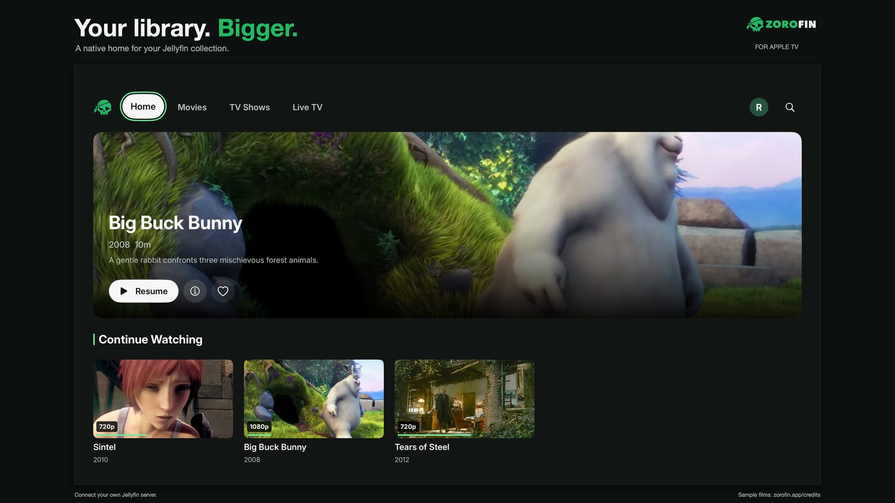
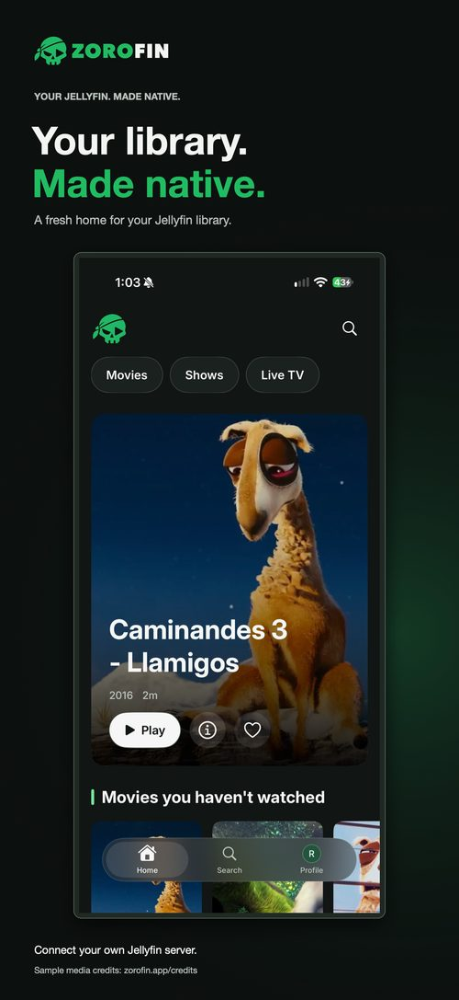
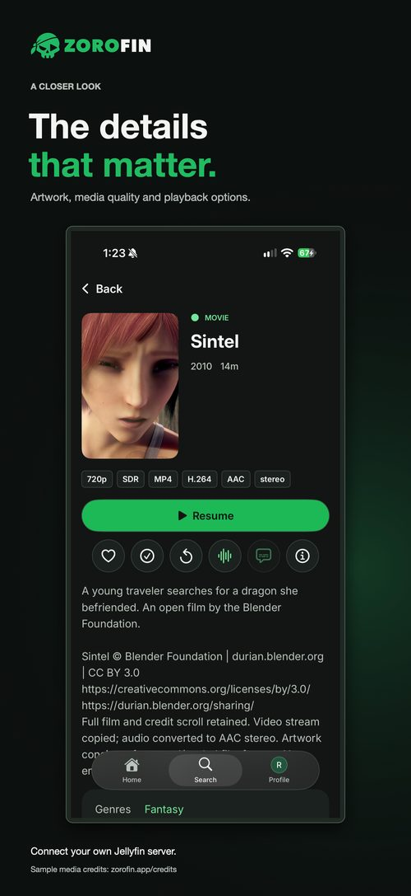
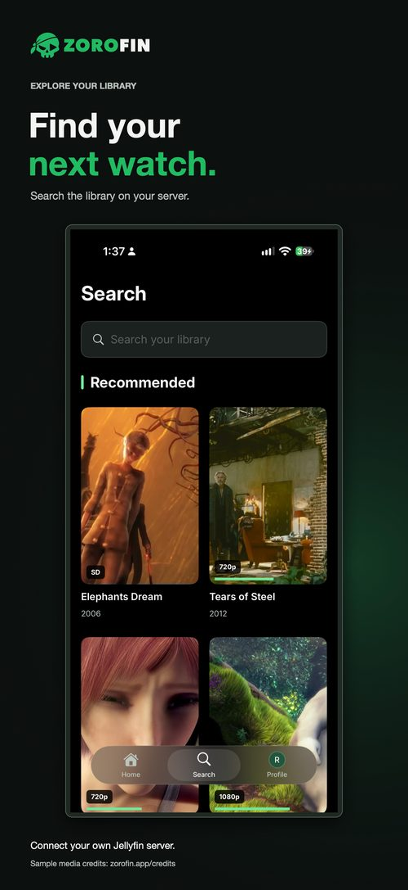
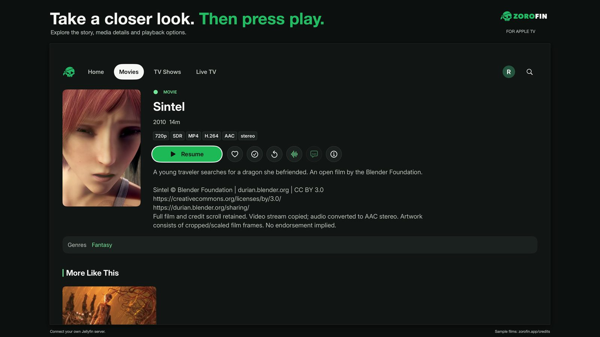
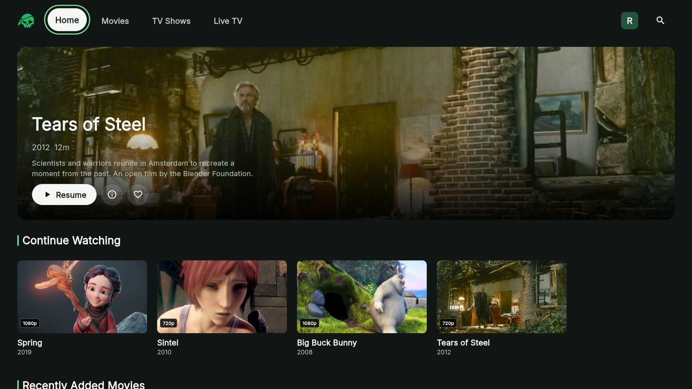

<div align="center">


# Zorofin

**A polished, native Jellyfin client for every screen you watch on.**

iPhone · iPad · Apple TV · Android TV · Google TV · Fire TV · LG webOS · Samsung Tizen · Roku

[Website](https://zorofin.app) ·
[App Store](https://apps.apple.com/us/app/zorofin/id6826013941) ·
[Amazon Appstore](https://www.amazon.com/gp/product/B0HQBMFSRN) ·
[Contributing](CONTRIBUTING.md) ·
Discussions



</div>

Zorofin connects to the Jellyfin server you already run. There is no account to
create, no Zorofin cloud in the middle and no tracking: your server, your
library, your sign-in. Every app aims for the same features and the same level
of polish, so the TV in the living room works like the phone in your hand.

## Features

- **Home that feels like a streaming app:** a featured banner, Continue
  Watching, New episodes, and poster rows with trailer previews on TV.
- **Native players** with direct play first, subtitles, audio track choice,
  Up next, and remote and gesture controls built for each platform.
- **Live TV** with a guide, channel logos and a sports row for your teams.
- **Profiles:** "Who's watching?" on TVs, saved accounts and Quick Connect
  sign-in.
- **Watch together** using Jellyfin SyncPlay.
- **Requests, alerts and more** when your server runs the optional
  [Zorofin plugin](https://github.com/Zoraz01/jellyfin-plugin-zorofin) and
  [companion](https://github.com/Zoraz01/zorofin-companion). Without them, Zorofin
  is a full client for any plain Jellyfin server.

<p align="center">
  
  
  
</p>
<p align="center">
  
  
</p>

## What's in this repository

| Folder | Platforms | Built with |
| --- | --- | --- |
| [`apps/apple`](apps/apple) | iPhone, iPad, Apple TV | Swift, SwiftUI, AVKit |
| [`apps/tv`](apps/tv) | Android TV, Google TV, Fire TV, Android phones and tablets, LG webOS, Samsung Tizen | Flutter |
| [`apps/roku`](apps/roku) | Roku | BrightScript, SceneGraph |
| [`apps/legacy-tv`](apps/legacy-tv) | Older Samsung TVs (Tizen 3.0 to 5.5) | Plain JavaScript web app |
| [`docs`](docs) | Shared platform notes and test checklists | |

The server side lives in two sibling repositories:
[jellyfin-plugin-zorofin](https://github.com/Zoraz01/jellyfin-plugin-zorofin)
(GPL-3.0) and [zorofin-companion](https://github.com/Zoraz01/zorofin-companion)
(AGPL-3.0).

## Build it yourself

Each app folder has its own README with full instructions. The short version:

```sh
# Apple (macOS with Xcode)
swift test --package-path apps/apple/Core
open apps/apple/Zorofin.xcodeproj        # schemes Zorofin-iOS and Zorofin-tvOS

# Android, Fire TV, LG, Samsung (Flutter)
cd apps/tv && flutter pub get && flutter test && flutter run

# Roku (Node 20+)
cd apps/roku && npm ci && npm test && npm run build

# Older Samsung TVs (Node 20+)
cd apps/legacy-tv && npm ci && npm test
```

You need a Jellyfin server to sign in to. The apps also have a preview mode with
sample titles, and [`apps/apple/demo-server`](apps/apple/demo-server) sets up a
throwaway Jellyfin with free Blender films if you want real playback.

## Contributing

Bug reports, fixes and new ideas are welcome. Start with
[CONTRIBUTING.md](CONTRIBUTING.md); issues labelled
`good first issue`
are a good place to begin. Please follow the [Code of Conduct](CODE_OF_CONDUCT.md),
and report security problems privately as described in [SECURITY.md](SECURITY.md).

Zorofin is built largely with AI coding assistants, and every change is reviewed
and tested by a person before release.

## License

The source code is licensed under the [Mozilla Public License 2.0](LICENSE).
You can use, change and ship it, including in your own apps, as long as changes
to these files stay open under the same license.

The Zorofin name, logo and wordmark are not part of that license. See
[TRADEMARKS.md](TRADEMARKS.md) before you publish a fork. Sample films in the
screenshots are Blender Foundation open movies, see
[docs/images/CREDITS.md](docs/images/CREDITS.md).

Jellyfin is a trademark of its respective owners. Zorofin is not affiliated with
or endorsed by the Jellyfin project.
